# Multi-Agent Warehouse Pathfinding with Local, Negotiation-Based Plan Repair

## 1. Problem

A team of robots works on a 2D grid warehouse. Each robot starts at its own home cell and gets an ordered list of objects to fetch. For each object it goes to the pickup cell next to a shelf, spends one step picking the object up, carries it to a delivery station, and spends one step dropping it off. When all its tasks are done, the robot returns home and parks. At every time step a robot either moves to one of its four neighbouring cells or waits. Two robots may never be in the same cell at the same time (vertex conflict), and two robots may never swap cells in one step (edge conflict).

The initial plans come from a multi-agent pathfinder based on Space-Time A*. While the robots execute those plans, three kinds of disruption can occur:

| Disruption | Model |
|---|---|
| Cell blockage | A free cell becomes impassable for d steps (d is drawn from 10–20). The blockage is announced when it starts. |
| Agent breakdown | A robot stops where it is for d steps (d is drawn from 10–20). While it is down, it is an obstacle to everyone else. |
| Emergency task | A robot gets a high-priority pickup and delivery. The new task is inserted at the front of its queue, or right after its current delivery if it is carrying an object. |

When a disruption happens, the robots must repair their plans without calling the multi-agent planner again, and the repair should change as few robots' plans as possible.

To find where the system fails (Section 6), two *permanent* disruptions are also modelled: a robot that breaks down for good, and a cell that is blocked for good.

### Summary of results

| Requirement | Where | Result |
|---|---|---|
| Total time steps of all agents | §4.2–4.8 | Sum of costs grows linearly with the fleet (676 steps for 5 robots to 7,490 for 50). Disruptions add 4–13% at density 1% and about 21% at density 10%. Local repair costs at most 1.1% more total time than a full replan over whole runs. |
| Agents whose plans change for one disruption | §4.1 | 1.1–3.5 robots with local repair for 10–50 robots (most of them hit directly by the disruption), against 2.8–45 for a full replan. |
| Effect of the number of agents | §4.2, §4.7 | Changed plans per event grow slowly (1.1 → 2.1 from 5 to 100 robots); a full replan grows from 2.3 to 28.7. Repair stays at 4–140 ms per event; full replan reaches 13 s. |
| Effect of the obstacle density | §4.3 | Extra time grows linearly with density; changed plans per event stay at about 1.4 for every density. |
| Settings in which the agents fail | §6 | (1) Dense dynamic obstacles with large fleets: purely local repair delivers every task in at least 95% of runs only up to density 15% for 10–20 robots, 10% for 30 robots, 5% for 40–50 robots and 0% for 60–70 robots. At 30% density, 90–100% of runs with 30 or more robots fail. The robots deadlock in single-lane gaps. (2) Permanent breakdowns, permanently blocked cells and blocked delivery stations make tasks impossible: each dead robot costs about 2.7–2.9 tasks, and each blocked station about 1/14 of all deliveries. |
| Graphical demonstration | §5 | Nine animated GIFs in `results/gifs/`, including two failure cases. |

## 2. System design

### 2.1 Map

`make_warehouse()` builds an 18 × 35 grid with 438 free cells. It has 24 shelf blocks of 2 × 4 cells, separated by one-wide vertical aisles and two-wide horizontal aisles. The map also has:

- 248 pickup cells, which are the free cells next to a shelf;
- 14 delivery stations on the left and right edges;
- 70 home cells on the top and bottom rows. Rows 1 and H-2 stay free as corridors, so a parked robot never walls anything off.

Exp G uses a bigger version of the same layout: 26 × 55 cells, 60 shelf blocks and 110 home cells.

### 2.2 Shared reservation table ([warehouse/reservation.py](warehouse/reservation.py))

Every committed plan is stored in a space-time reservation table. The table holds:

- vertex reservations `(cell, t)`;
- edge reservations `(u → v, t)`, which are used to detect swaps;
- a parking reservation `(cell, from t onwards)` for a robot that has finished its route.

The table allows more than one owner per entry. After a disruption, a robot's old plan can overlap with a new constraint, such as a broken robot that now occupies a cell. That overlap is exactly how the system finds the robots whose plans have become invalid.

### 2.3 Initial planning: prioritized Space-Time A* ([warehouse/planner.py](warehouse/planner.py))

- **Space-Time A\*** searches over `(cell, t)` states. The actions are four moves plus wait. The heuristic is the true shortest-path distance on the static map, precomputed by BFS, so it is admissible and consistent.
- The search treats all reserved vertices and swap edges as obstacles, along with any dynamic blockage that is already known.
- A pickup or drop goal is reached only if the robot can also stay on the goal cell for the following step, which is the service step.
- The home goal is reached only if the robot can park there for good: no other reservations on that cell at any later time and no blockage on it later.
- Once `t` passes the last reserved time step, the world no longer changes. States `(cell, t)` and `(cell, t')` are then treated as the same state. This keeps the search finite even when the goal cannot be reached.
- **Multi-leg route:** the legs pickup₁ → drop₁ → pickup₂ → … → home are chained. Each leg starts where and when the previous leg ended.
- **Prioritized planning (Cooperative A\*):** robots plan one after another. Each robot treats the plans of all robots before it as moving obstacles. If a robot fails to find a plan, it is moved to the front of the order and the rest of the order is shuffled.

### 2.4 Detecting who is disrupted ([warehouse/simulator.py](warehouse/simulator.py))

A disruption at time t is detected by querying the reservation table. The planner is not involved at this stage.

| Disruption | Directly disrupted robots |
|---|---|
| Blockage of cell c during [t, t+d) | The owners of any reservation on `(c, t')` for t' in that interval |
| Breakdown of robot a at cell p | Robot a gets a forced stay `(p, t..t+d)`, so its plan must change. Also every robot that owns a reservation on p during the stay. |
| Emergency for robot a | Only robot a |

### 2.5 Local repair ([warehouse/repair.py](warehouse/repair.py))

Each disrupted robot is repaired in order of its first clash, using escalating levels. Robots that are already down are frozen: they are never asked to move. A broken robot's own continuation from time t+d is planned last, after the other robots have cleared its cell.

| Level | What happens | Plans changed |
|---|---|---|
| **L0: wait insertion** | The robot keeps its original route and inserts waits just before the conflict until the rest of its plan is valid again. | Only the disrupted robot |
| **L1: solo detour** | The robot runs Space-Time A* from its current `(cell, t)` over its remaining legs. The plans of all other robots are hard constraints. | Only the disrupted robot |
| **L2: negotiation** | The robot asks its neighbours to give way (described below). | The disrupted robot plus the neighbours that accept |

The robot takes the better of L0 and L1. It accepts that result if its delay is at most τ = 8 steps. Otherwise it tries L2. If L2 fails, it keeps the L0/L1 result anyway.

**L2 negotiation protocol.** Each message is counted in the results.

1. **REQUEST:** the disrupted robot A broadcasts to every non-broken robot within a communication radius R, measured as Manhattan distance. R starts at 4 and widens to 8 and then 16 if needed.
2. A plans with Space-Time A*. The neighbours' reservations are soft: A may violate them at a cost of τ per conflict. Everyone else's reservations remain hard. The search therefore minimises *time + τ × (number of conflicts)*. It chooses to disturb a neighbour only if that saves more than τ steps.
3. **PROPOSE:** A sends its path to each neighbour B that the path conflicts with. A's new path is now committed, so B must plan around it.
4. **ACCEPT or REJECT:**
   - B accepts if it can repair itself with L0 or L1 at a delay of at most 30 steps.
   - Otherwise B may run its own L2 negotiation. This can recurse to a depth of 2, and robots already in the coalition cannot be asked again.
   - If any robot rejects, the whole coalition is rolled back through an undo log, so the negotiation is all-or-nothing. A then tries again with a wider radius.
5. **Emergency robot:** it tries L1 first. It accepts L1 if it arrives within 2 steps of the static lower bound. Otherwise it negotiates with priority: the conflict penalty drops to 1, so the emergency robot takes the fastest route and its neighbours make way.
6. **Last resort:** if every local option fails, the robot negotiates with no radius limit and a deeper recursion.
7. **If even that fails**, there are two modes, chosen by the `fallback` switch of the simulator:
   - *Purely local* (`fallback=False`): the multi-agent planner is never called. The system declares the disruption unrepairable, the run halts at that time step, and every task not delivered by then counts as failed. Section 6 uses this mode to find where the method breaks.
   - *Safety net* (`fallback=True`, used in Exps A–H so that the runs can be compared end to end): the global planner is called once for this event and the record is marked as a *fallback*. This happened for 5 of the 32,120 disruptions handled in Exps A–H (0.016%). In every other case the multi-agent planner was **not** re-invoked. Section 6.1 reports both modes side by side, so the effect of the safety net is visible: it widens the range in which runs succeed, but it fails too at the highest densities.

**Invariant.** After every repair, all plans are conflict-free with each other and with all known blockages. In test mode (`check=True`) this is asserted after every event. The simulator also checks for vertex collisions, swap collisions and robots standing on blocked cells at every step. The number of collisions was 0 in every run.

### 2.6 Baseline ([warehouse/baseline.py](warehouse/baseline.py))

The baseline shows what the assignment rules out. After every disruption that affects at least one robot, it runs the whole prioritized planner again for every robot that still has work. The emergency robot goes first, then broken robots, then the rest by id. The baseline runs on exactly the same scenarios. If the prioritized planner finds no joint plan after 30 random priority orders, the simulator restores the previous plans and handles that event with local repair, so the run can continue; it records this as a baseline failure. That never happened in the final runs.

## 3. Experimental setup ([experiments/run_experiments.py](experiments/run_experiments.py))

**Common settings**
- Unless stated otherwise, each robot has 3 tasks, each with a random pickup cell and a random station. Every run continues until all tasks are delivered and all robots are parked.
- **Dynamic-obstacle density ρ:** the expected fraction of free cells that are blocked at any moment. Blockages arrive as a Poisson process with rate ρ · N_free / 15 per step, with durations drawn from 10–20.
- Each disrupted scenario is compared with a reference run of the same scenario with no disruptions.

**Metrics**
- *Sum of costs*: the sum over robots of the time step of each robot's last delivery. This is the "total time steps required by all agents".
- *Makespan*: the time step of the last delivery.
- *Extra time*: sum of costs minus the sum of costs of the same scenario with no disruptions.
- *Agents changed*: the number of robots whose future plan differs after the event. This is measured directly by comparing every robot's plan before and after the event.
- *Collateral*: the changed robots that the disruption did not hit directly, i.e. neighbours that gave way.
- Messages exchanged and CPU time per event.

**Experiments**

| Exp | What varies | Fixed settings | Seeds |
|---|---|---|---|
| A: single disruption | N ∈ {10, 20, 30, 40, 50} × 3 disruption types | One event between t = 10 and t = 30, aimed at a moving robot (for a blockage, a cell on some robot's route 3–8 steps ahead) | 30 |
| B: number of agents | N ∈ {5, 10, 20, 30, 40, 50} | ρ = 1%, 2 breakdowns, 1 emergency | 30 |
| C: obstacle density | ρ ∈ {0, 0.5, 1, 2, 3, 5, 7.5, 10}% | N = 20, 2 breakdowns, 1 emergency | 30 |
| D: delay tolerance τ | τ ∈ {0, 2, 4, 8, 16, 32, ∞} | N = 40, one blockage or breakdown, local repair only | 30 |
| E: communication radius R | R ∈ {1, 2, 4, 8, 16, ∞} | N = 40, one disruption of each type, local repair only | 30 |
| F: simultaneous breakdowns | k ∈ {1, 2, 4, 8, 12} robots break down in the same time step | N = 30 | 30 |
| G: bigger warehouse | N ∈ {25, 50, 75, 100} on the 26 × 55 map | ρ = 1%, 2 breakdowns, 1 emergency | 10 |
| H: tasks per robot | 1, 3, 5 or 8 tasks | N = 20, ρ = 1%, 2 breakdowns, 1 emergency | 30 |
| I: failure settings | Density up to 30% × N up to 70, with and without global fallback; long blockages; permanent breakdowns, blockages and blocked stations | See Section 6 | 20–30 |

For Exps A–H there are 3,320 simulation runs, plus a no-disruption reference run for each scenario. All values below are means with 95% confidence intervals. The raw data is in `results/*.csv`, and every table, with all rows, is in [results/summary.md](results/summary.md).

Exp I adds 2,630 runs.

**Correctness across all runs**
- 0 collisions and 0 timeouts in all 5,950 runs.
- In Exps A–H every task was delivered. Exp I deliberately includes settings where tasks are not delivered (Section 6).
- Local repair needed the global fallback for 5 of 32,120 disruptions in Exps A–H.
- Exp I deliberately pushes the system past its limits. There, runs stop early or tasks are lost (Section 6), but there were still 0 collisions.

## 4. Results

### 4.1 Impact of one disruption: robots whose plans change (Exp A)

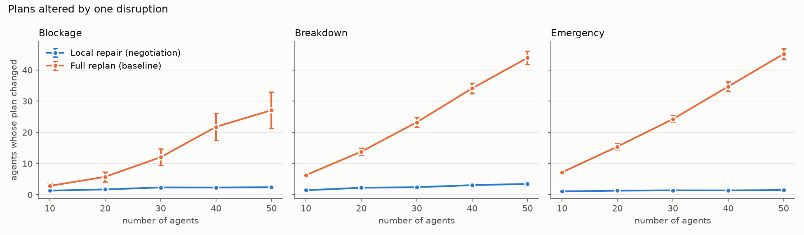

| Disruption | N | Local repair: plans changed | of which collateral | Full replan: plans changed |
|---|---|---|---|---|
| Blockage | 10 | 1.30 ± 0.19 | 0.00 | 2.83 ± 0.76 |
| Blockage | 30 | 2.33 ± 0.47 | 0.03 | 12.03 ± 2.64 |
| Blockage | 50 | 2.40 ± 0.44 | 0.13 | 27.10 ± 5.80 |
| Breakdown | 10 | 1.43 ± 0.26 | 0.00 | 6.27 ± 0.59 |
| Breakdown | 30 | 2.40 ± 0.54 | 0.00 | 23.23 ± 1.54 |
| Breakdown | 50 | 3.47 ± 0.62 | 0.17 | 43.90 ± 2.13 |
| Emergency | 10 | 1.07 ± 0.09 | 0.07 | 7.17 ± 0.60 |
| Emergency | 30 | 1.40 ± 0.26 | 0.40 | 24.23 ± 1.13 |
| Emergency | 50 | 1.50 ± 0.29 | 0.50 | 45.13 ± 1.73 |

- With local repair, the number of changed plans stays at about 1–3.5 robots per disruption as the fleet grows from 10 to 50 robots. Most of those are robots the disruption hit directly. On average, at most 0.5 extra robots are asked to give way.
- A full replan changes almost every active robot's plan: 27–45 of 50 robots. Re-running prioritized planning reshuffles everyone's route, even when only one robot was affected.
- Across the 450 single-disruption repairs, the levels used were: L1 detour 274, L2 negotiation 165, L2 priority (emergency) 118, yield by a neighbour 67, recursive yield 2, and L0 wait 1. L0 is rare because a detour is almost always strictly faster than waiting out a 10–20-step blockage, and L0 is kept only on a tie.

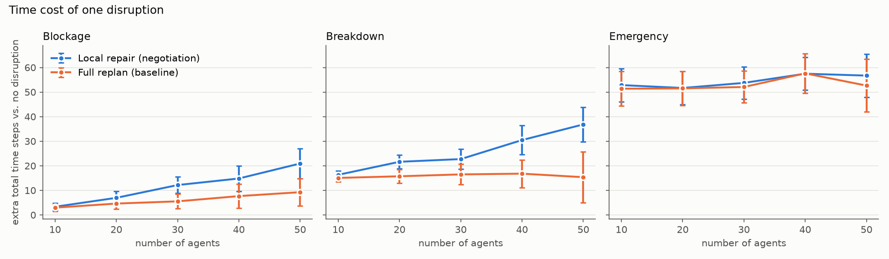

**Price of stability.** Keeping everyone else's plan fixed costs some total time:

- With 50 robots, one breakdown adds 36.8 ± 7.0 steps under local repair and 15.4 ± 10.4 under a full replan. One blockage adds 20.9 ± 6.1 steps under local repair and 9.3 ± 5.5 under a full replan.
- A full replan can reorder priorities globally and let a delayed robot go first. Local repair deliberately does not do that.
- For emergencies, both methods cost about the same, 51–58 steps. That time is mostly the work of the new task itself.

### 4.2 Scaling with the number of agents (Exp B)

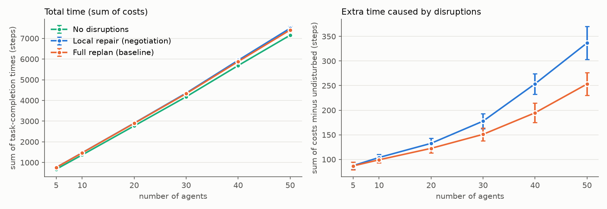
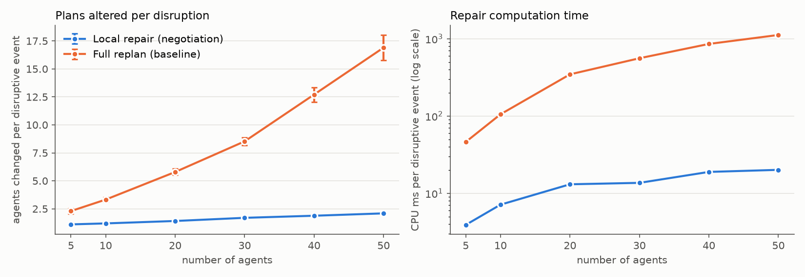

| N | Sum of costs (no disruptions) | Sum of costs, repair | Sum of costs, replan | Extra time, repair | Extra time, replan | Plans changed per event, repair | Plans changed per event, replan | CPU ms per event, repair | CPU ms per event, replan |
|---|---|---|---|---|---|---|---|---|---|
| 5 | 676 | 763 | 762 | 87 | 87 | 1.11 | 2.30 | 3.9 | 46 |
| 10 | 1368 | 1472 | 1468 | 104 | 99 | 1.20 | 3.33 | 7.1 | 105 |
| 20 | 2771 | 2904 | 2893 | 133 | 122 | 1.41 | 5.79 | 13.1 | 346 |
| 30 | 4178 | 4356 | 4329 | 178 | 151 | 1.70 | 8.53 | 13.6 | 559 |
| 40 | 5686 | 5940 | 5881 | 254 | 195 | 1.88 | 12.71 | 18.9 | 856 |
| 50 | 7154 | 7490 | 7407 | 337 | 253 | 2.09 | 16.90 | 20.1 | 1118 |

- Total time grows roughly linearly with the number of robots, since each robot has 3 tasks. Makespan stays at about 198–216 steps because the robots work in parallel.
- Disruptions add 4–13% to the total time. The share is larger for small fleets, because the two breakdowns and the emergency task cost about the same whatever the fleet size.
- At 5–20 robots, local repair and full replan cost almost the same time. At 40–50 robots, where congestion is higher, local repair costs about 1% more total time: 7,490 against 7,407 steps at N = 50.
- In return, local repair changes 8.1× fewer plans per event at N = 50, and its computation is about 56× cheaper: 20 ms against 1,118 ms per event. The replan cost grows with N, while the repair cost stays nearly flat.

### 4.3 Scaling with dynamic-obstacle density (Exp C, N = 20)

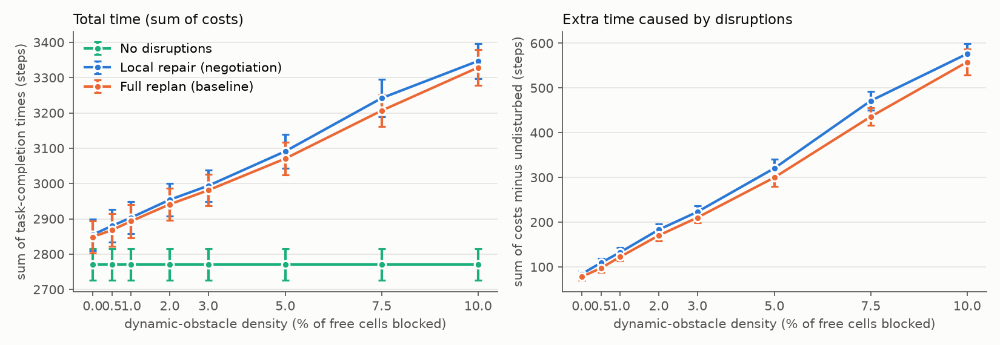
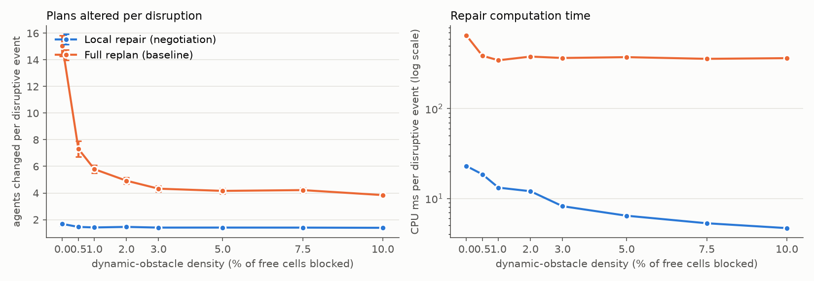

| ρ | Events that disrupted a robot | Extra time, repair | Extra time, replan | Plans changed per event, repair | Plans changed per event, replan | CPU ms per event, repair | CPU ms per event, replan |
|---|---|---|---|---|---|---|---|
| 0% | 3.0 | 84 | 78 | 1.68 | 15.06 | 23.0 | 653 |
| 0.5% | 13.6 | 109 | 97 | 1.45 | 7.32 | 18.6 | 388 |
| 1% | 23.4 | 133 | 122 | 1.41 | 5.79 | 13.2 | 346 |
| 2% | 45.3 | 183 | 170 | 1.46 | 4.92 | 12.0 | 380 |
| 3% | 66.3 | 223 | 210 | 1.40 | 4.33 | 8.2 | 367 |
| 5% | 102.0 | 321 | 300 | 1.40 | 4.16 | 6.4 | 375 |
| 7.5% | 162.0 | 471 | 436 | 1.40 | 4.22 | 5.3 | 359 |
| 10% | 217.8 | 576 | 558 | 1.39 | 3.84 | 4.7 | 365 |

- The number of events that actually disrupt a robot grows linearly with ρ, and the extra time grows with it. At ρ = 10%, extra time is about 21% of the undisturbed total for both methods, and makespan rises from 203 steps at ρ = 0% to 238 at ρ = 10%.
- Local repair still changes about 1.4 plans per disruptive event at every density. Its total time stays within 1.1% of the full replan's: 3,347 against 3,329 steps at ρ = 10%.
- The replan's number of changed plans per event goes down as ρ grows. This is because most of the extra events are small blockages late in the run, when fewer robots are still active. At ρ = 0% the only events are the breakdowns and the emergency, which change 15 of 20 plans under a full replan.
- Local repair gets cheaper per event as density rises (23 ms down to 5 ms) because most extra events are blockages fixed by a quick L1 detour. The replan cost stays at about 360 ms per event.

### 4.4 Delay tolerance τ (Exp D, N = 40)

| τ | Blockage: plans changed | Blockage: extra steps | Breakdown: plans changed | Breakdown: extra steps |
|---|---|---|---|---|
| 0 | 2.63 | 14.0 | 3.43 | 29.6 |
| 8 (default) | 2.30 | 14.8 | 3.07 | 30.5 |
| ∞ (never negotiate) | 2.27 | 14.8 | 3.00 | 30.3 |

- τ sets how much delay the disrupted robot accepts before asking neighbours to move. A smaller τ means more negotiation (4.5–7.5 messages instead of almost none) and a few more changed plans, with at most about 1 step less total time.
- The effect is small because most conflicts are resolved by a cheap solo detour.
- The remaining gap to the full replan in §4.1 is therefore not caused by timid negotiation. It comes from keeping the *priorities* of the unaffected robots fixed.

### 4.5 Communication radius R (Exp E, N = 40)

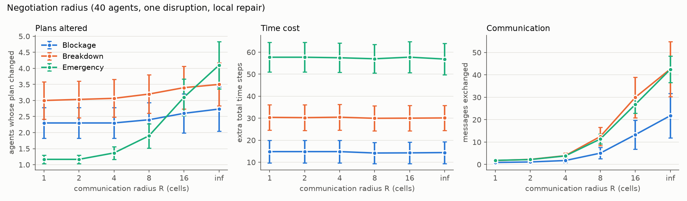

| R | Blockage: plans changed | Breakdown: plans changed | Emergency: plans changed | Emergency: messages | Emergency: extra steps |
|---|---|---|---|---|---|
| 1 | 2.30 | 3.00 | 1.17 | 1.8 | 57.7 |
| 4 (default) | 2.30 | 3.07 | 1.37 | 3.8 | 57.5 |
| 8 | 2.40 | 3.20 | 1.90 | 11.4 | 57.0 |
| 16 | 2.60 | 3.40 | 3.10 | 26.8 | 57.7 |
| ∞ | 2.73 | 3.50 | 4.10 | 42.5 | 56.9 |

- A wider radius lets the disrupted robot ask more neighbours to give way. It uses that freedom, but the time saved is within noise: for every disruption type, extra time stays flat within ±1 step.
- The cost is more plan changes and more messages. For an emergency, an unlimited radius changes 3.5× more plans (4.1 against 1.17) and sends 24× more messages than R = 1.
- The effect is largest for emergencies because the emergency robot negotiates with priority. With a large radius it pushes aside robots that it could have routed around.
- **Takeaway:** negotiating only with close neighbours best meets the goal of minimising changed plans. The default R = 4 costs almost nothing extra over R = 1 and leaves room to escalate when a robot is boxed in.

### 4.6 Several robots breaking down at once (Exp F, N = 30)

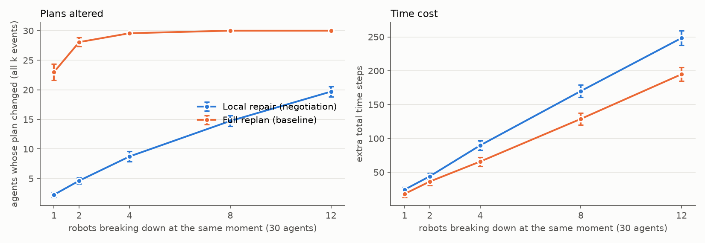

| k robots down | Local repair: plans changed | Full replan: plans changed | Extra time, repair | Extra time, replan | CPU ms, repair | CPU ms, replan |
|---|---|---|---|---|---|---|
| 1 | 2.27 | 23.00 | 24.4 | 18.1 | 29 | 597 |
| 2 | 4.63 | 28.07 | 44.1 | 36.4 | 56 | 1,358 |
| 4 | 8.73 | 29.57 | 89.7 | 65.8 | 139 | 3,546 |
| 8 | 14.73 | 30.00 | 170.0 | 128.9 | 220 | 6,786 |
| 12 | 19.70 | 30.00 | 248.3 | 194.8 | 282 | 10,726 |

- Local repair handles each breakdown in turn. The number of changed plans grows with k at about 1.6–2.3 plans per broken robot, which includes the broken robot itself.
- A full replan already changes almost all 30 plans for k = 2, and all of them from k = 8.
- The time gap grows with k: 248 against 195 extra steps at k = 12, about 27% more. With many robots down at once, the best order changes a lot, and only the full replan can reorder everyone.
- Local repair stays about 38× cheaper to compute: 0.28 s against 10.7 s for 12 breakdowns.

### 4.7 A bigger warehouse with up to 100 robots (Exp G)

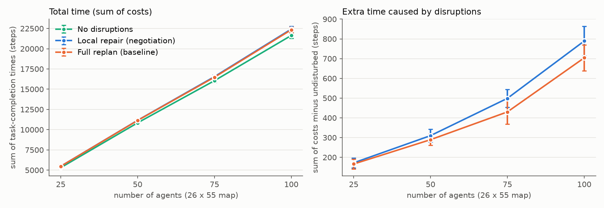
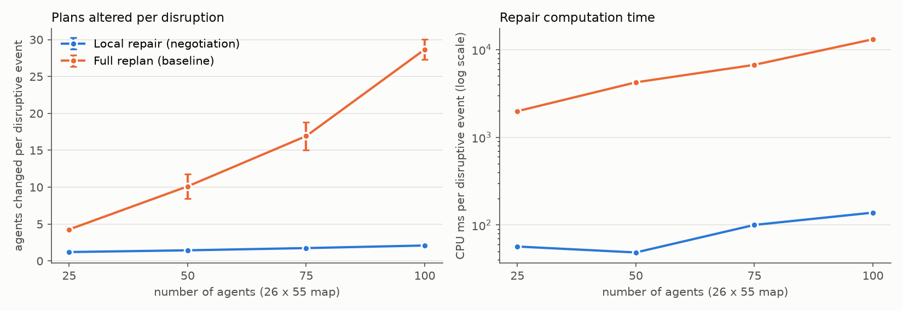

| N | Sum of costs, repair | Sum of costs, replan | Plans changed per event, repair | Plans changed per event, replan | CPU ms per event, repair | CPU ms per event, replan |
|---|---|---|---|---|---|---|
| 25 | 5,479 | 5,473 | 1.21 | 4.27 | 57 | 1,987 |
| 50 | 11,154 | 11,134 | 1.44 | 10.11 | 49 | 4,239 |
| 75 | 16,549 | 16,481 | 1.74 | 16.93 | 100 | 6,712 |
| 100 | 22,426 | 22,341 | 2.10 | 28.67 | 139 | 13,133 |

- The results from the small map hold on a map with more than twice as many free cells. With 100 robots, local repair changes 2.1 plans per disruption against 28.7 for a full replan, and its total time is only 0.4% higher.
- Computation is where the full replan stops being practical. It needs 13 s per disruption at N = 100, against 0.14 s for local repair. With about 110 disruptive events in a run, that is about 24 minutes of planning against 15 seconds.
- This made Exp G the slowest part of the sweep: about 2.4 hours of the 3.1 hours total, almost all of it in the baseline.

### 4.8 Tasks per robot (Exp H, N = 20)

| Tasks per robot | Sum of costs, repair | Sum of costs, replan | Plans changed per event, repair | Plans changed per event, replan | CPU ms per event, repair | CPU ms per event, replan |
|---|---|---|---|---|---|---|
| 1 | 961 | 961 | 1.42 | 4.57 | 4.6 | 168 |
| 3 | 2,904 | 2,893 | 1.41 | 5.79 | 13.8 | 358 |
| 5 | 4,781 | 4,758 | 1.38 | 6.21 | 18.8 | 711 |
| 8 | 7,662 | 7,619 | 1.47 | 7.75 | 25.7 | 858 |

- Longer task lists make every plan longer and busier. Under a full replan, the number of changed plans per event grows from 4.6 to 7.8.
- Local repair stays at about 1.4 changed plans per event whatever the length of the task lists. Its total time is within 0.6% of the full replan's.

## 5. Visual simulations

`python visualize.py --preset all` writes nine animations to [results/gifs/](results/gifs/). All nine runs were collision-free.

| GIF | Scenario |
|---|---|
| [demo.gif](results/gifs/demo.gif) | 15 robots, ρ = 2%, 3 breakdowns, 2 emergencies |
| [blockages.gif](results/gifs/blockages.gif) | 20 robots, blockages only, ρ = 5% |
| [breakdowns.gif](results/gifs/breakdowns.gif) | 25 robots, 6 breakdowns, no blockages |
| [emergencies.gif](results/gifs/emergencies.gif) | 20 robots, 4 emergency tasks |
| [dense.gif](results/gifs/dense.gif) | 50 robots, ρ = 2% |
| [bigmap.gif](results/gifs/bigmap.gif) | 60 robots on the 26 × 55 map |
| [compare.gif](results/gifs/compare.gif) | The same 25-robot scenario under local repair (top) and full replan (bottom) |
| [failure_deadlock.gif](results/gifs/failure_deadlock.gif) | **Failure:** 40 robots, ρ = 20%, purely local repair. The robots deadlock at t = 142 with 60 of 120 tasks delivered (Section 6.1) |
| [failure_permanent.gif](results/gifs/failure_permanent.gif) | **Failure:** 25 robots, 3 robots break down for good and 3 delivery stations are blocked for good. 56 of 75 tasks are delivered (Section 6.3) |

In the animations, a red cell is a blockage, a dark red cell is blocked for good, a black ✕ is a broken robot, a grey ✕ is a robot that broke down for good, a thick red ring marks a robot whose repair failed, violet is a robot on an emergency task, and an orange ring plus an orange line marks a robot whose plan just changed, with its next 12 steps. In `compare.gif`, local repair has made 38 plan changes by t = 60, against 186 for the full replan.

The demo run also produces one snapshot per disruption type, such as this blockage repair:

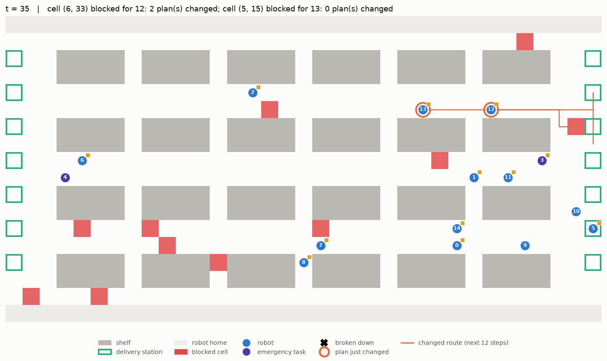

## 6. Failure settings: where the agents do not complete their tasks (Exp I)

Exps A–H were run in settings where the system works. Exp I looks for the settings where it does not. A run counts as a **success** only if every task is delivered. A run can fail in two ways:

- **Halt (deadlock):** a disruption leaves some robots with no conflict-free plan. In purely local mode the multi-agent planner may not be called, so the run stops at that time step. The tasks not delivered by then count as failed.
- **Lost tasks:** a permanent disruption makes a task impossible, for example because its pickup cell is blocked for good. The system detects this by a reachability check on the static map, drops the task, and the other robots carry on.

Exp I ran 2,630 runs. None of them had a collision: the system either finds a valid plan or stops; it never executes an invalid one.

### 6.1 Dense dynamic obstacles and large fleets: deadlock

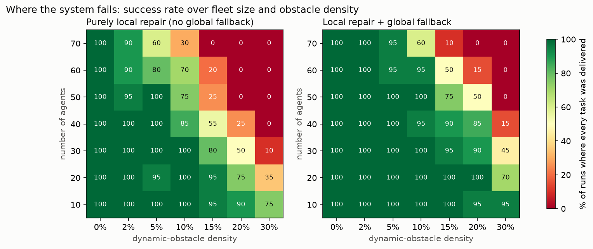

Each cell of the heat map is the share of 20 runs in which every task was delivered (3 tasks per robot, 2 breakdowns, 1 emergency, blockages lasting 10–20 steps). The left map uses purely local repair; the right map adds the global fallback.

**Failure settings with purely local repair:**

| Fleet size | Highest density with ≥ 95% success | Lowest density at which half or more of the runs fail | Tasks delivered at ρ = 30% |
|---|---|---|---|
| 10 robots | 15% | > 30% (75% success at 30%) | 80% |
| 20 robots | 15% | 30% (35% success) | 47% |
| 30 robots | 10% | 20% (50% success) | 28% |
| 40 robots | 5% | 20% (25% success) | 7% |
| 50 robots | 5% | 15% (25% success) | 4% |
| 60 robots | 0% (90% at 2%) | 15% (20% success) | 2% |
| 70 robots (every home cell used) | 0% (90% at 2%) | 10% (30% success) | 1% |

**Why the robots fail.** At high density the blocked cells often leave only one-cell-wide gaps between shelves. Two robots then meet head-on in such a gap, or a robot is boxed in between blocked cells and other robots' committed paths. Local repair keeps every other robot's plan fixed, except the neighbours it negotiates with, so it can only search the space those plans leave free. When the conflict involves a chain of robots longer than the recursion depth, or robots that are boxed in themselves, every local option fails. The snapshot below shows the deadlock from `failure_deadlock.gif`: the robots with thick red rings are the ones the repair could not fix.

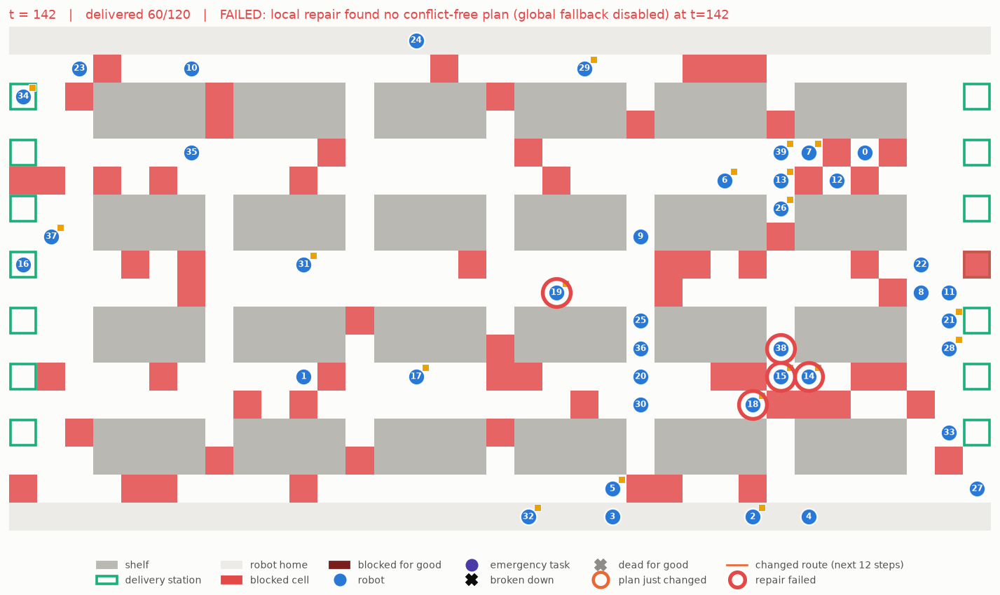

**The global fallback widens the safe range but does not remove the failure.** For example, with 40 robots at ρ = 15% it raises the success rate from 55% to 90%, and with 70 robots at ρ = 10% from 30% to 60%. At ρ = 30% with 40 or more robots, and at ρ = 20% with 60 or more robots, it also fails in almost every run (0–15% success), because prioritized planning is incomplete: no priority order of the robots yields a joint plan. Each rescue also costs a full replan, which is exactly what the assignment wants to avoid.

**Fleet size makes it worse.** More robots means more committed paths, so fewer free cells and more chained conflicts. With 70 robots, every home cell is in use, and even 5% density makes 40% of the runs fail.

### 6.2 Long blockages are not a failure setting

At 30 robots and ρ = 10%, raising the mean blockage duration from 15 to 180 steps does not change the outcome: 95–100% of the runs succeed in both modes. A long blockage is announced together with its duration, so robots simply detour around it. What matters is how many cells are blocked **at the same time**, not for how long.

### 6.3 Permanent disruptions: tasks that can never be done

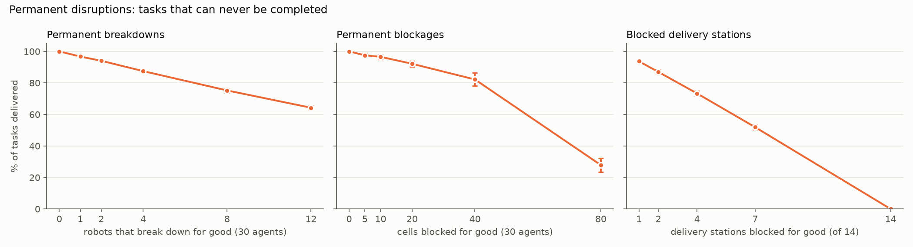

| Setting (30 robots, 90 tasks) | Tasks delivered | Main cause of lost tasks |
|---|---|---|
| 1 robot breaks down for good | 96.7% | The dead robot's own remaining tasks (2.5); another robot's pickup or drop cell is occupied by the dead robot (0.4) |
| 4 robots break down for good | 87.5% | Same; 11.3 tasks lost |
| 12 robots break down for good | 64.3% | Same; 32 tasks lost |
| 5 random cells blocked for good | 97.5% (40% of runs fully succeed) | The blocked cell is a pickup cell or a station |
| 40 random cells blocked for good | 82.2% | Same, plus a few cells walled off |
| 80 random cells blocked for good (22% of free cells) | 27.9%; 93% of runs halt | Deadlock in the remaining single-lane passages, as in 6.1 |
| 1 delivery station blocked for good | 93.7% | Every task assigned to that station |
| 7 of 14 stations blocked for good | 51.9% | Same |
| All 14 stations blocked | 0% | No delivery is possible |

- **Permanent breakdown.** The system has no task reallocation: the dead robot's undelivered tasks are lost, and so is any task whose pickup or drop cell the dead robot now occupies. The other robots repair locally around the dead robot and finish their own work; none of these runs halted.
- **Permanent blockage.** A blocked pickup cell or station makes every task that uses it impossible, because each task has one fixed pickup cell and one fixed station. With 80 blocked cells, most runs deadlock. In those runs every stuck robot could still reach all of its goals if it were alone on the map. The failure comes from coordination, not from reachability.
- **Blocked station.** Each blocked station removes about 1/14 of all deliveries, because tasks are spread evenly over the 14 stations.

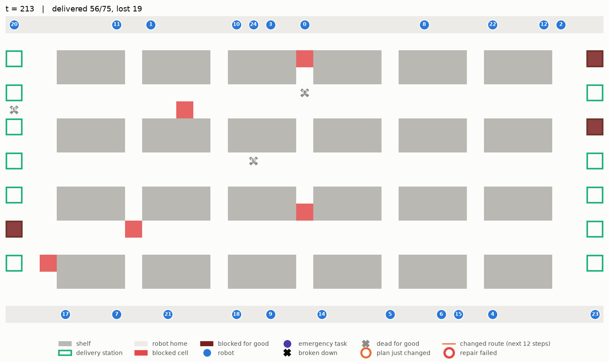

### 6.4 Summary of failure settings

| # | Setting | What happens |
|---|---|---|
| 1 | Purely local repair with dynamic-obstacle density ≥ 20% and ≥ 30 robots, ≥ 15% and ≥ 50 robots, or ≥ 10% and 70 robots | Half or more of the runs deadlock and halt before all tasks are delivered |
| 2 | Density 30% with ≥ 40 robots, or 20% with ≥ 60 robots, even with the global fallback | 85–100% of runs deadlock; prioritized global replanning fails too |
| 3 | Fleet that fills every home cell (70 robots) | Fails from density 2–5% |
| 4 | A robot breaks down for good | Its remaining tasks are lost (about 2.7–2.9 tasks per dead robot); no reallocation |
| 5 | A pickup cell or delivery station blocked for good | Every task using it is lost; no alternative station is chosen |
| 6 | Many cells (≥ 20% of the map) blocked for good | Remaining passages become single lanes; runs deadlock |

**How these failures could be fixed** (not implemented):
- Task reallocation through an auction when a robot dies, and choosing the nearest open station when a station is blocked. This would remove failures 4 and 5.
- A complete multi-agent method (such as CBS) in the last-resort step, or letting robots back out of single-lane passages (as in push-and-swap). This would remove most failures of types 1–3 and 6.
- Admission control: limit the number of robots active in a region when the local obstacle density is high.

## 7. Discussion and limitations

- **Plan modification is local.** For a single disruption, the number of changed plans stays at 1–3.5 as the fleet grows to 50 robots, and at about 2 with 100 robots on the bigger map. It is also nearly flat across obstacle densities and task-list lengths. The breakdown case grows slowly because a broken robot in a busy aisle blocks more robots at larger N. The full replan changes most plans, and its cost grows with N.
- **Trade-off.** Local repair gives up a little total time in exchange for stable plans and cheap computation. Across whole runs this is at most 1.1% of total time. For isolated events in dense fleets it is larger: about 2.4× the full replan's extra time for a single breakdown with 50 robots, and 27% more for 12 simultaneous breakdowns. Stable plans matter in practice, because every plan change must be sent to a robot and can invalidate reservations for the lifts, doors and chargers the robot has already booked.
- **Tuning.** Exp D and E show that the time gap does not come from the negotiation settings. Negotiating more (smaller τ, larger R) changes more plans without saving time. The gap comes from keeping the unaffected robots' priorities fixed.
- **Completeness.** Prioritized planning, and repairs that keep other plans fixed, are not complete. In Exps A–H the escalation chain (wider radius, recursive negotiation, and as a safety net a global replan) always recovered; the global replan was needed for 5 of 32,120 disruptions. Section 6 shows where this breaks: at high obstacle density with large fleets, and with permanent disruptions.
- **Search limit.** On the bigger map a robot sometimes has to wait about 150 steps before it can park, because a higher-priority robot crosses its home cell late. The A* expansion limit was raised from 80,000 to 500,000 nodes for this, and all experiments were rerun with the new limit.
- **Assumptions.**
  - A blockage's duration is known when it appears. With unknown durations, the robot would re-plan when the estimate expires.
  - Communication is reliable and instantaneous within the radius. Messages are counted but not delayed.
  - A robot carries one object at a time. An emergency waits for the current drop-off.
- **Possible extensions.**
  - Let the coalition swap priorities, so that a delayed robot may cut in front of a neighbour that has more slack. This would target the remaining time gap.
  - A windowed (rolling-horizon) repair for very long plans.
  - Reassigning a broken robot's tasks through an auction when the breakdown is permanent.

## 8. Reproducing

```bash
python3 -m venv .venv && .venv/bin/pip install -r requirements.txt
.venv/bin/pytest -q                                          # 12 tests, including collision-free end-to-end runs and failure handling
.venv/bin/python experiments/run_experiments.py              # all experiments A-I, about 3.5 hours on 8 cores
.venv/bin/python experiments/run_experiments.py --only I     # failure settings only, about 25 minutes
.venv/bin/python experiments/run_experiments.py --only ABCDEFH   # everything except the big map, about 40 minutes
.venv/bin/python visualize.py --preset all                   # the nine GIFs
.venv/bin/python build_pdf.py                                # REPORT.md -> REPORT.pdf
```
